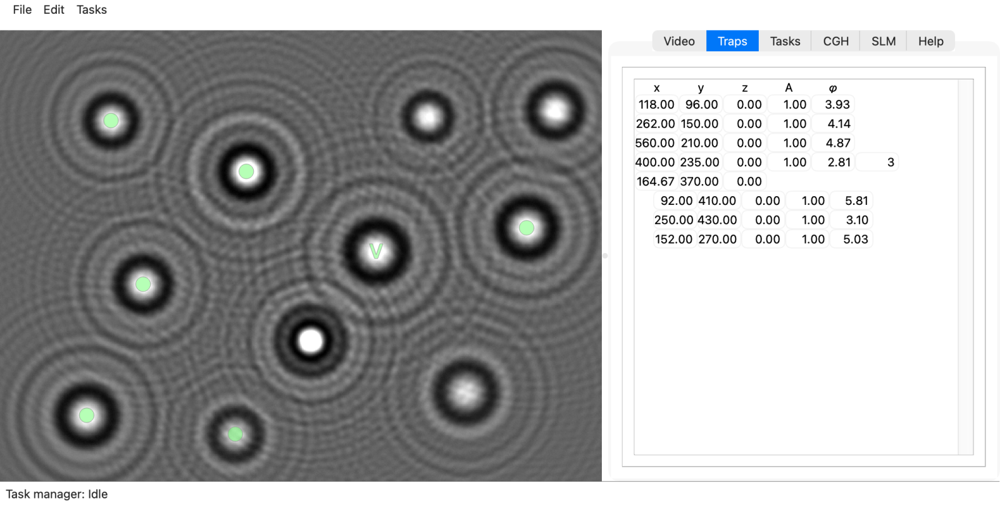

QHOT
====

QHOT is a Python application for holographic optical trapping — controlling
spatial light modulators (SLMs) to create, move, and reconfigure optical
traps in real time using a live camera feed.

         on the video screen, with optical traps on seven of them, and the
         Video tab beside it.
   :width: 100%

   The QHOT window on a 1080p display.  The video screen shows holograms of
   colloidal spheres at different heights above the focal plane, with
   optical traps on seven of them (the markers grow with the height of the
   trap).  The Video tab beside it has the recorder, the controls of a
   GenICam camera and the filter rack.  The frame is made up, as
   ``devel/screenshot.py`` explains; the window is the program itself.

.. toctree::
   :maxdepth: 2
   :caption: Contents

   background
   architecture
   queues
   api/application
   api/lib
   api/holograms
   api/traps
   api/tasks
   references

Indices
-------

* :ref:`genindex`
* :ref:`modindex`
